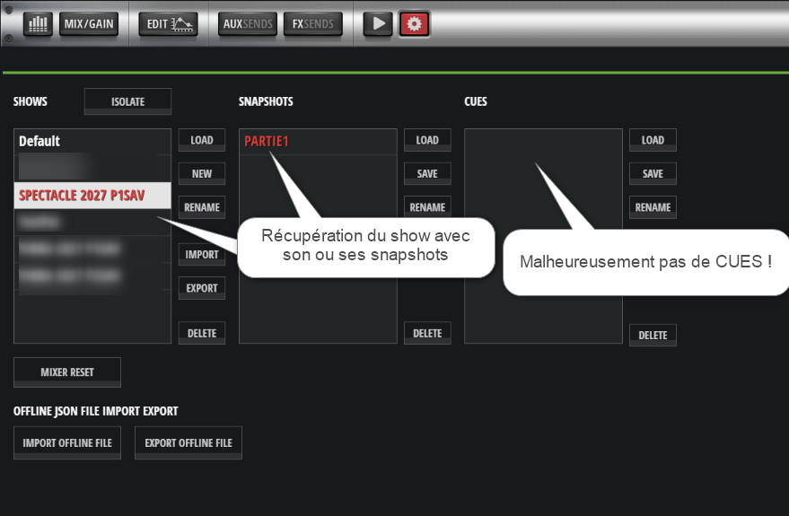

# Fonctionnement technique de RestoreCUE

## 1. Objectif

RestoreCUE reconstruit des Cues d'un Show Soundcraft Ui24R à partir de fichiers d'export `.uicue` disponibles sur l'ordinateur, par exemple après copie d'une sauvegarde USB.

Le nom du dossier sélectionné sert de nom de Show cible. Le nom de chaque fichier `.uicue`, sans son extension, sert de nom de Cue.

## 2. Préparation des fichiers
 Avant de lancer RestoreCUE, il faut disposer des fichiers .uicue issus de l'export du Show à restaurer.
 
### Exemple de l'interface native de la Soundcraft Ui24R



*Figure 1 – Interface de la Soundcraft Ui24R présentant un Show,
un Snapshot et une liste de Cues vide.*

Dans cet exemple, le Show et son Snapshot sont présents dans
la console, mais aucun Cue n'apparaît dans la colonne CUES.

RestoreCUE répond précisément à ce manque : il permet de restaurer les Cues à partir des fichiers d'export individuels `.uicue`.

1. Exporter le Show de la console Soundcraft vers une clé USB
2. Connecter la clé USB de sauvegarde à l'ordinateur, ou copier les fichiers de sauvegarde dans un dossier accessible.
3. Copier le fichier Python V10RestoreCUE.py sur la clé USB ou dans le dossier de travail contenant la sauvegarde du Show.
4. Ouvrir un terminal sur l'ordinateur (PowerShell sous Windows ou Bash sous Linux Mint) et saisir la commande correspondant au système utilisé :
   - Windows (PowerShell) : `python V10RestoreCUE.py`
   - Linux Mint (Bash) : `python3 V10RestoreCUE.py`
5. Indiquer l'adresse IP de la console Soundcraft à laquelle l'ordinateur est connecté en RJ45
6. Indiquer le répertoire dans lequel rechercher les dossiers de Shows.
7. Sélectionner par numéro le dossier contenant les fichiers `.uicue`.

Le programme recherche les dossiers contenant directement des fichiers `.uicue`. Il affiche le nombre de fichiers détectés pour chaque dossier.

Les noms de fichiers contenant des caractères encodés au format URL sont décodés pour l'affichage et l'envoi des noms de Cues. Cela permet notamment de retrouver les caractères accentués : `B%C3%A9a` devient `Béa`.  


## 3. Lecture des fichiers `.uicue`

Le programme utilise deux lectures distinctes :

-   une lecture filtrée destinée à la visualisation des paramètres reconnus ;
-   une lecture exhaustive destinée à la restauration.

La restauration conserve l'ordre des lignes/commandes du fichier. Les commandes ne sont pas limitées au sous-ensemble de paramètres utilisé par la fonction de visualisation.

Lors des essais rapportés, un Cue comportait 2 356 commandes à envoyer.

## 4. Connexion à la Ui24R

RestoreCUE établit une connexion avec la console en utilisant son adresse IP et le port configuré dans le programme. Il effectue une négociation HTTP afin d'établir une connexion WebSocket, utilisée ensuite pour échanger les messages du protocole Socket.IO avec la console.

Le programme utilise un verrou d'envoi afin d'éviter que plusieurs threads n'entrelacent les octets de leurs trames WebSocket.

> [!TIP]
> **Connexion Ethernet recommandée**
> 
> RestoreCUE a été testé avec une liaison Ethernet filaire (RJ45) entre l'ordinateur et la console Soundcraft Ui24R.
> 
> Une utilisation en Wi-Fi peut être techniquement envisageable, mais cette configuration n'a pas été testée ni validée. Le Wi-Fi pouvant introduire des variations de latence et des délais de transmission supplémentaires, une liaison filaire est recommandée pour garantir des conditions de communication aussi stables que possible pendant la restauration des Cues.
> 
> Les temps d'exécution présentés dans la documentation correspondent exclusivement aux essais réalisés en connexion filaire.

## 5. Vérification préalable du Show — `SHOWLIST`

Avant toute restauration, RestoreCUE envoie :

```text
3:::SHOWLIST
```

La console renvoie une liste de noms de Shows séparés par le caractère `^`, par exemple :

```text
3:::SHOWLIST^Default^REPETITION^TestPat
```

RestoreCUE compare le nom du dossier sélectionné avec les noms reçus.

-   Si le Show est présent, la restauration peut continuer.
-   Si le Show est absent, le programme arrête l'opération avant l'envoi des commandes `SETD` et `SAVECUE`.
-   Si aucune réponse n'est reçue dans le délai prévu, la vérification échoue et l'opération ne doit pas continuer.

Cette vérification évite de commencer une restauration vers un Show qui n'a pas été confirmé dans la liste de la console.

## 6. Envoi des paramètres — `SETD`

Pour chaque paramètre lu dans un fichier `.uicue`, le programme envoie une commande de la forme :

```text
3:::SETD^clé^valeur
```

Les commandes sont envoyées dans l'ordre du fichier, sans filtrage des clés pour la restauration.

**Important :** les commandes `SETD` modifient les paramètres du mix actif de la console pendant la reconstruction. Il est donc recommandé de sauvegarder les Shows importants et d'effectuer les premiers essais sur un Show de test.

## 7. Enregistrement du Cue — `SAVECUE`

Après l'envoi des paramètres d'un Cue, le programme envoie :

```text
3:::SAVECUE^nom_du_show^nom_du_cue
```

Cette commande demande à la console d'enregistrer l'état courant sous le nom du Cue dans le Show indiqué.

Le programme attend ensuite le délai configuré avant de passer au Cue suivant. Dans la configuration testée récemment, ce délai était de 0,3 seconde.

La commande `LOADCUE` n'est pas utilisée. RestoreCUE reconstruit les Cues à partir des fichiers en envoyant les paramètres avec `SETD`, puis en les enregistrant avec `SAVECUE`.

## 8. Vérification finale — `CUELIST`

Après l'enregistrement des Cues sélectionnés, RestoreCUE demande la liste des Cues du Show :

```text
3:::CUELIST^nom_du_show
```

La réponse observée utilise le nom du Show et des noms de Cues séparés par `^`, par exemple :

```text
3:::CUELIST^TestPat^CUE1^CUE2^CUE3
```

Le programme compare les noms attendus avec les noms retournés par la console, puis affiche :

-   le nombre de Cues attendus ;
-   le nombre de Cues retrouvés ;
-   le nombre de Cues manquants ;
-   le nombre total de Cues présents dans le Show.

**Limite de cette vérification :** `CUELIST` confirme la présence des noms des Cues. Cette réponse ne vérifie pas individuellement les valeurs des paramètres enregistrés dans chaque Cue.

## 9. Réception des messages et gestion des threads

Un thread d'observation est chargé de lire les messages reçus sur la connexion WebSocket. Il traite notamment :

-   les réponses `SHOWLIST` et `CUELIST`, transmises au programme principal par une file d'attente ;
-   les messages de heartbeat Socket.IO `2::`, auxquels le programme répond selon le comportement implémenté ;
-   les trames de contrôle WebSocket, notamment les PING/PONG.

Un autre thread envoie périodiquement le message `3:::ALIVE`.

À la fin de l'opération, le programme demande l'arrêt des threads, attend leur terminaison, puis ferme le socket. Cette séquence a été mise en place à la suite de messages `WinError 10053` observés lors d'une fermeture plus précoce de la connexion.

## 10. Délais et estimation du temps

Les délais de configuration utilisés lors des derniers essais concluants étaient :

```python
DELAY_BETWEEN_PARAMS = 0.001
DELAY_AFTER_CUE = 0.3
```

L'estimation du temps est calculée à partir du nombre de commandes, des délais configurés et d'une marge. Le temps réel est mesuré jusqu'à la fin de l'arrêt des threads et de la fermeture du socket.

Les durées affichées sont des estimations ; elles peuvent varier selon la console, le réseau, le nombre de Cues et les traitements effectués par la console.

## 11. Sauvegardes et précautions

-   Conserver une copie des fichiers `.uicue` d'origine.
-   Effectuer une sauvegarde du Show avant une restauration importante.
-   Tester d'abord sur un Show de test.
-   Vérifier le résultat final et, pour les productions importantes, rappeler les Cues sur la console afin de contrôler leurs réglages.
-   Ne pas considérer la seule présence d'un nom dans `CUELIST` comme une preuve de l'intégrité de toutes les valeurs de paramètres.