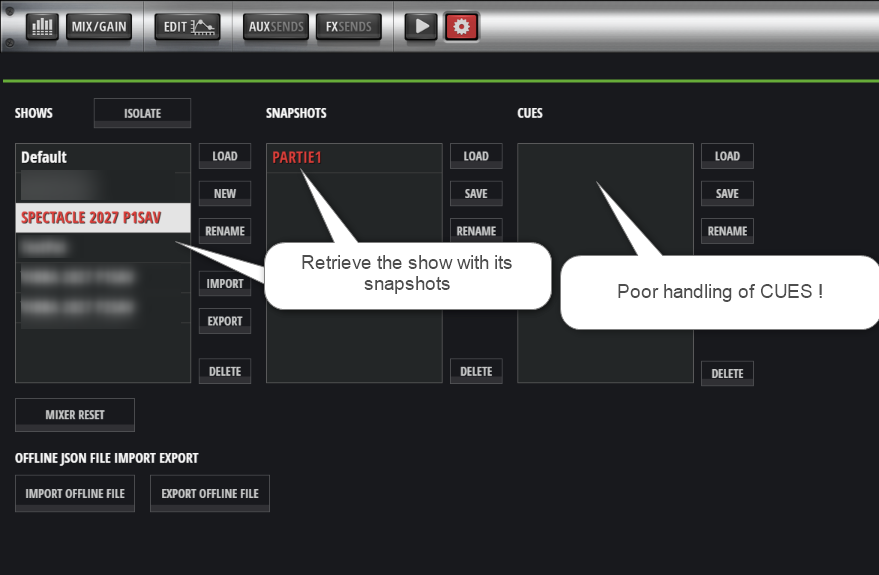

# RestoreCUE – Technical Overview

## 1. Purpose

RestoreCUE rebuilds Cues in a Soundcraft Ui24R Show from `.uicue` export files available on the computer, for example after copying a USB backup.

The name of the selected folder is used as the target Show name. The name of each `.uicue` file, without its extension, is used as the Cue name.

## 2. File Preparation

Before running RestoreCUE, the `.uicue` files exported from the Show to be restored must be available.

### Example of the Soundcraft Ui24R Native Interface



*Figure 1 – Soundcraft Ui24R interface showing a Show, a Snapshot and an empty Cue list.*

In this example, the Show and its Snapshot are present in the console, but no Cues appear in the CUES column.

RestoreCUE addresses this specific issue: it allows Cues to be restored from individual `.uicue` export files.

1. Export the Show from the Soundcraft console to a USB drive.
2. Connect the USB backup drive to the computer, or copy the backup files to an accessible folder.
3. Copy the Python file `V10RestoreCUE.py` to the USB drive or to the working folder containing the Show backup.
4. Open a terminal on the computer (PowerShell on Windows or Bash on Linux Mint) and enter the command corresponding to the operating system:
   - Windows (PowerShell): `python V10RestoreCUE.py`
   - Linux Mint (Bash): `python3 V10RestoreCUE.py`
5. Enter the IP address of the Soundcraft console to which the computer is connected via Ethernet (RJ45).
6. Specify the directory in which the Show folders are to be searched.
7. Select by number the folder containing the `.uicue` files.

The program searches for folders that directly contain `.uicue` files. It displays the number of files detected in each folder.

File names containing URL-encoded characters are decoded for display and when sending Cue names. This makes it possible, in particular, to restore accented characters: `B%C3%A9a` becomes `Béa`.

## 3. Reading `.uicue` Files

The program uses two separate reading processes:

- a filtered reading used to display recognized parameters;
- an exhaustive reading used for restoration.

The restoration preserves the order of the lines/commands in the file. Commands are not restricted to the subset of parameters used by the display function.

During the reported tests, each Cue contained 2,356 commands to be sent.

## 4. Connecting to the Ui24R

RestoreCUE establishes a connection to the console using its IP address and the port configured in the program. It performs an HTTP handshake to establish a WebSocket connection, which is then used to exchange Socket.IO protocol messages with the console.

The program uses a send lock to prevent multiple threads from interleaving the bytes of their WebSocket frames.

> [!TIP]
> **Wired Ethernet connection recommended**
>
> RestoreCUE has been tested using a wired Ethernet (RJ45) connection between the computer and the Soundcraft Ui24R console.
>
> Wi-Fi operation may be technically possible, but this configuration has not been tested or validated. Since Wi-Fi can introduce latency variations and additional transmission delays, a wired connection is recommended to provide the most stable communication conditions possible during Cue restoration.
>
> The execution times presented in the documentation are based exclusively on tests performed using a wired connection.

## 5. Preliminary Show Verification — `SHOWLIST`

Before starting any restoration, RestoreCUE sends:

```text
3:::SHOWLIST
```

The console returns a list of Show names separated by the `^` character, for example:

```text
3:::SHOWLIST^Default^REPETITION^TestPat
```

RestoreCUE compares the selected folder name with the names received.

- If the Show is present, restoration can continue.
- If the Show is absent, the program stops the operation before sending any `SETD` or `SAVECUE` commands.
- If no response is received within the specified timeout, verification fails and the operation must not continue.

This verification prevents restoration from starting on a Show that has not been confirmed in the console's Show list.

## 6. Sending Parameters — `SETD`

For each parameter read from a `.uicue` file, the program sends a command in the following format:

```text
3:::SETD^key^value
```

Commands are sent in the order in which they appear in the file, without filtering keys during restoration.

**Important:** `SETD` commands modify the console's active mix settings during reconstruction. It is therefore recommended to back up important Shows and perform initial tests on a test Show.

## 7. Saving the Cue — `SAVECUE`

After sending all the parameters for a Cue, the program sends:

```text
3:::SAVECUE^show_name^cue_name
```

This command asks the console to save the current state under the specified Cue name in the indicated Show.

The program then waits for the configured delay before moving on to the next Cue. In the configuration tested most recently, this delay was 0.3 seconds.

The `LOADCUE` command is not used. RestoreCUE rebuilds Cues from the files by sending parameters using `SETD`, then saving them using `SAVECUE`.

## 8. Final Verification — `CUELIST`

After saving the selected Cues, RestoreCUE requests the list of Cues belonging to the Show:

```text
3:::CUELIST^show_name
```

The observed response contains the Show name followed by the Cue names, separated by `^`, for example:

```text
3:::CUELIST^TestPat^CUE1^CUE2^CUE3
```

The program compares the expected names with the names returned by the console, then displays:

- the number of expected Cues;
- the number of Cues found;
- the number of missing Cues;
- the total number of Cues present in the Show.

**Verification limitation:** `CUELIST` confirms that the Cue names are present. This response does not individually verify the parameter values saved in each Cue.

## 9. Message Reception and Thread Management

A monitoring thread is responsible for reading messages received through the WebSocket connection. It handles, in particular:

- `SHOWLIST` and `CUELIST` responses, which are forwarded to the main program through a queue;
- Socket.IO heartbeat messages `2::`, to which the program responds according to the implemented behavior;
- WebSocket control frames, including PING/PONG.

Another thread periodically sends the `3:::ALIVE` message.

At the end of the operation, the program requests the threads to stop, waits for them to terminate, and then closes the socket. This sequence was implemented following `WinError 10053` messages observed when the connection was closed too early.

## 10. Delays and Time Estimation

The configuration delays used during the most recent successful tests were:

```python
DELAY_BETWEEN_PARAMS = 0.001
DELAY_AFTER_CUE = 0.3
```

The time estimate is calculated based on the number of commands, the configured delays and an additional margin. The actual execution time is measured until the threads have stopped and the socket has been closed.

Displayed durations are estimates; they may vary depending on the console, the network, the number of Cues and the processing performed by the console.

## 11. Backups and Precautions

- Keep a copy of the original `.uicue` files.
- Back up the Show before performing an important restoration.
- Always test on a test Show first.
- Check the final result and, for important productions, recall the Cues on the console to inspect their settings.
- Do not consider the mere presence of a name in `CUELIST` as proof that all parameter values have been restored correctly.